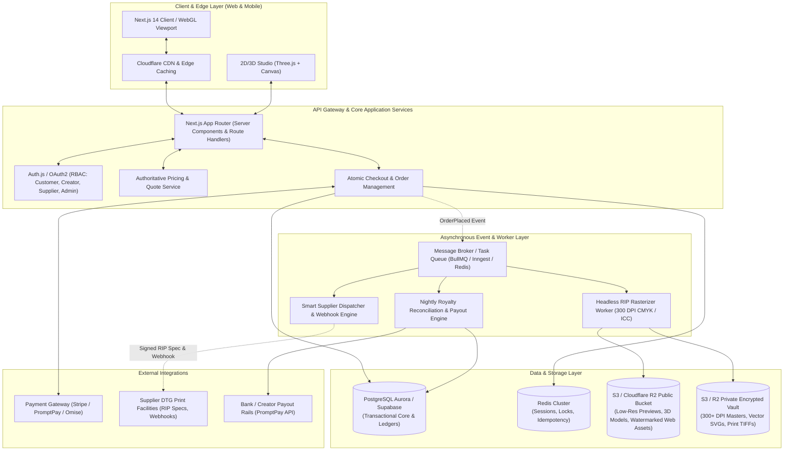
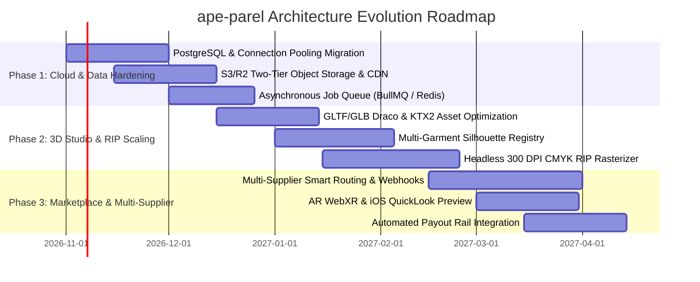

# ape-parel: Long-Term Enterprise Architecture Specification
**Platform:** Independent Creator-Powered Streetwear & 3D Customization Marketplace  
**Version:** 2.0 (Target Architecture Blueprint)  
**Authors:** Agents Factory Squad (`tech_lead_agent`, `studio_3d_agent`, `code_reviewer_agent`, `qa_engineer_agent`)  
**Date:** 2026-10-11  

---

## 1. Executive Summary & Architectural Vision

The **ape-parel** platform operates at the intersection of **3D Interactive WebGL Customization**, **Decentralized Creator Licensing**, and **Physical Print-on-Demand (POD) Manufacturing**. 

While the MVP (Generation 9) successfully established:
- Pixel-accurate 1:1 Planar UV projection (`tshirt.obj`) with Three.js
- Server-authoritative pricing validation (THB 410 benchmark)
- Double-entry immutable royalty accounting (`RoyaltyObligation`, `RoyaltyLedgerEntry`, `FinancialAccount`)
- 334/334 passing Vitest test suites

The **Long-Term Enterprise Architecture** addresses key production scaling vectors:
1. **High-Concurrency Scale:** Transitioning from single-file SQLite to a resilient PostgreSQL cluster with Redis caching and connection pooling.
2. **Zero-Trust Artwork IP Vault:** Isolating high-resolution master graphics from browser access, streaming only watermarked previews to clients, and reserving 300+ DPI assets strictly for headless RIP workers.
3. **Multi-Silhouette 3D Garment Pipeline:** Moving beyond a single hardcoded T-shirt OBJ to a dynamic Garment Asset Registry utilizing compressed **glTF/GLB with Draco & KTX2**, with parametric UV projection matrices.
4. **Event-Driven Fulfillment & RIP Rasterization:** Decoupling the checkout transaction from heavy image rasterization via asynchronous message queues, automatic supplier routing, and multi-tier webhook integrations.

---

## 2. High-Level System Architecture Diagram



---

## 3. Four Core Architectural Pillars (Factory Squad Analysis)

### Pillar A: Cloud-Native Data & Event Architecture (`tech_lead_agent`)
- **Database Evolution:**
  - Migrate Prisma schema from `sqlite` to `postgresql` with connection pooling (`pgbouncer`).
  - Implement read replicas for marketplace browsing and creator analytics dashboards.
- **Transactional Outbox Pattern:**
  - Instead of executing supplier notifications and RIP image generation inside the synchronous HTTP checkout request, orders emit an immutable `OrderPlaced` event within an atomic database transaction.
  - Background workers pick up tasks with guaranteed at-least-once delivery and idempotency keys (`idempotency_key = order_id + status`).
- **Distributed Caching:**
  - Redis caches garment catalog definitions, creator storefront metadata, and active pricing rules.

### Pillar B: Next-Gen 3D Garment Asset & UV Pipeline (`studio_3d_agent`)
- **glTF / GLB + Draco & KTX2 Migration:**
  - Replace raw text Wavefront `.obj` files with Draco-compressed `.glb` assets, reducing model download size from ~550KB to <90KB.
  - Utilize KTX2 / Basis Universal compressed textures to drop GPU VRAM usage by over 60% on mobile browsers.
- **Configuration-Driven Garment Registry:**
  - Abstract planar UV unwrapping from hardcoded T-shirt geometry into a polymorphic garment registry:
    ```typescript
    interface GarmentModelSpec {
      id: string; // e.g. "OVERSIZED_HOODIE_01", "BOXY_TEE_HEAVY"
      modelGlbUrl: string;
      surfaces: {
        front: { uBounds: [number, number]; vBounds: [number, number]; normalThreshold: number };
        back:  { uBounds: [number, number]; vBounds: [number, number]; normalThreshold: number };
        sleeves?: { left: [number, number]; right: [number, number] };
      };
      platenPhysicalCm: { width: number; height: number };
      anchorPoints: { sternum: [number, number, number]; hem: [number, number, number] };
    }
    ```
- **Server-Side Headless Texture Baking:**
  - Implement a Node.js / `@napi-rs/canvas` worker to bake high-resolution 4096x4096px composite textures for 3D renderings and AR QuickLook (USDZ) export.

### Pillar C: Zero-Trust Artwork IP Vault & Security (`code_reviewer_agent`)
- **Two-Tier Storage Topology:**
  - **Tier 1 (Public CDN Bucket):** Only contains watermarked low-resolution raster previews (max 1000px, 72 DPI, with invisible perceptual hash watermark).
  - **Tier 2 (Private IP Vault Bucket):** High-resolution master assets (300 DPI PNG, CMYK TIFF, original vector SVGs). Direct public access is blocked (`BlockPublicAcls = true`).
- **Just-In-Time (JIT) Supplier Access:**
  - When an order enters `IN_PRODUCTION`, the RIP worker generates a single-use, cryptographically signed pre-signed URL expiring in 120 minutes, sent exclusively to the verified supplier endpoint.
- **Double-Entry Ledger Cryptographic Integrity:**
  - Each `JournalEntry` and `RoyaltyLedgerEntry` links to its predecessor via a SHA-256 rolling digest (`previousHash`), preventing silent database record alteration.

### Pillar D: Automated Adversarial QA & Reliability (`qa_engineer_agent`)
- **Visual Regression Testing with Playwright & Three.js:**
  - Automated CI tests rendering standard designs (e.g. chest mascot, center logo) across different viewport sizes and calculating pixel diff against golden baseline images ($<0.05\%$ tolerance).
- **Financial Chaos & Reconciliation Invariants:**
  - Automated continuous worker verifying the platform balance conservation equation:
    $$\sum \text{Debit}(\text{Escrow}) + \sum \text{Debit}(\text{Platform}) = \sum \text{Credit}(\text{Creator}) + \sum \text{Credit}(\text{Supplier})$$
  - Any drift immediately triggers an automated `DISCREPANCY` alert and halts automatic payouts.
- **Contract Testing for Suppliers:**
  - OpenAPI / JSON-Schema validation on all supplier dispatch payloads (`ProductionJobPackage`).

---

## 4. Phased Implementation Roadmap



---

## 5. Technology Matrix: Current MVP vs Long-Term Enterprise

| Vector | Current MVP (Gen 9) | Long-Term Enterprise Target | Business & Engineering Benefit |
| :--- | :--- | :--- | :--- |
| **Database** | SQLite (Single-file) | PostgreSQL + PgBouncer + Read Replicas | Eliminates write locks, supports horizontal scaling and multi-tenant failover |
| **File Storage** | Local filesystem (`public/uploads/`) | Cloudflare R2 / AWS S3 + Global CDN | Zero-downtime persistence, global edge acceleration, zero server disk bloat |
| **Artwork Security** | Direct file paths | Two-Tier IP Vault (Public Preview + Private Master + JIT Signed URLs) | Eliminates IP theft of high-resolution designer artwork |
| **3D Format** | Wavefront OBJ (~550KB) | glTF / GLB with Draco + KTX2 (<90KB) | 80%+ bandwidth reduction, instant loading on 4G/5G mobile devices |
| **Garment Variety** | Single T-shirt OBJ model | Polymorphic Garment Registry (Hoodies, Boxy Tees, Long sleeves) | Expands product catalog with zero architectural rewrites |
| **Print Generation** | Client-side Canvas rendering | Serverless Headless RIP Worker (300 DPI CMYK + White Underbase) | Direct integration with industrial DTG printers (Brother / Kornit) |
| **Order Processing** | Synchronous HTTP Request | Transactional Outbox + Asynchronous Event Broker | High checkout resilience during high-traffic streetwear drops |
| **Ledger Security** | Prisma model records | SHA-256 Hash-Chained Double-Entry Ledger | Audit-grade, tamper-evident financial accounting for creator royalties |
| **Testing & QA** | Vitest Unit & Integration (334 tests) | Vitest + Playwright 3D Visual Regression + Nightly Chaos Reconciliation | Zero visual distortion regressions and zero financial drift |
