# ape-parel: Sitemap & Role-Based Workspace Architecture
**Platform:** Independent Creator-Powered Streetwear & 3D Customization Marketplace  
**Specification:** Version 2.0 (Role Entries, Workflows, Workspaces & Next.js 14 App Router Hierarchy)  
**Authors:** Factory Squad (`tech_lead_agent`, `studio_3d_agent`, `code_reviewer_agent`, `qa_engineer_agent`)  
**Date:** 2026-10-11  

---

## 1. Architectural Philosophy: Role Segregation & Workspaces

The platform structure is organized into **4 primary roles**, each equipped with dedicated **Entry Points**, **Core Workflows**, and an isolated **Operational Workspace**:

1. **User / Customer (Customizer & Collector):** Discovers graphics, configures garments in real 3D, places atomic orders, and manages their personal collection via the **User Journal**.
2. **Creator / Designer (IP Merchant):** Uploads master assets to the Zero-Trust Vault, defines licensing tiers, customizes storefronts, and tracks royalty earnings via the **Creator Journal**.
3. **Administrator (Platform Operator & Auditor):** Governs platform content via the **Content Management System (CMS)**, manages access via **Users Management**, oversees double-entry financial reconciliation, and monitors immutable audit logs.
4. **Supplier / Print Partner (Manufacturer):** Receives RIP print packages, monitors print queues, downloads CMYK placement specs, and handles fulfillment dispatch.

---

## 2. Global Sitemap & Route Hierarchy (Next.js 14 App Router)

```mermaid
graph TD
    Root["/ (Root Domain)"]
    
    %% Public Routes
    Root --> Public["(Public Marketplace & Studio)"]
    Public --> Home["/ (Landing & Streetwear Drops)"]
    Public --> Market["/marketplace (Artwork & Garment Explorer)"]
    Public --> CreatorPublic["/creators/:slug (Creator Storefront)"]
    Public --> Studio["/studio/new & /studio/:designId (3D Customizer)"]
    
    %% Customer Workspace
    Root --> AccountGroup["(Customer Workspace) /account"]
    AccountGroup --> UserDashboard["/account (Overview)"]
    AccountGroup --> UserJournal["/account/journal (User Journal & Timeline)"]
    AccountGroup --> UserDesigns["/account/designs (Saved 3D Drafts)"]
    AccountGroup --> UserOrders["/account/orders (Order History & Tracking)"]
    AccountGroup --> UserSettings["/account/settings (Addresses & Preferences)"]
    
    %% Creator Workspace
    Root --> CreatorGroup["(Creator Workspace) /creator"]
    CreatorGroup --> CreatorDashboard["/creator/dashboard (Sales & Metrics)"]
    CreatorGroup --> CreatorJournal["/creator/journal (Royalty Ledger & Tax Logs)"]
    CreatorGroup --> CreatorArtworks["/creator/artworks (Portfolio & Vault Upload)"]
    CreatorGroup --> CreatorStorefront["/creator/storefront (Brand Styling & Bio)"]
    CreatorGroup --> CreatorPayouts["/creator/payouts (Settlement & Bank Accounts)"]
    CreatorGroup --> CreatorAnalytics["/creator/analytics (Artwork Performance)"]
    
    %% Admin Workspace
    Root --> AdminGroup["(Admin Workspace) /admin"]
    AdminGroup --> AdminOverview["/admin/dashboard (Platform Health & GMV)"]
    AdminGroup --> AdminContent["/admin/content (Content Management - CMS)"]
    AdminContent --> ContentModeration["/admin/content/moderation (Artwork Approvals)"]
    AdminContent --> ContentGarments["/admin/content/garments (Blank Garment Catalog)"]
    AdminContent --> ContentDrops["/admin/content/drops (Curated Drops & Banners)"]
    AdminGroup --> AdminUsers["/admin/users (Users Management & RBAC)"]
    AdminUsers --> UsersCustomers["/admin/users/customers (Customer Directory)"]
    AdminUsers --> UsersCreators["/admin/users/creators (KYC & Verification)"]
    AdminUsers --> UsersSuppliers["/admin/users/suppliers (SLA & Capacities)"]
    AdminGroup --> AdminFinance["/admin/finance (Financial Ledger & Audit)"]
    AdminFinance --> FinanceLedger["/admin/finance/ledger (Double-Entry Reconcile)"]
    AdminFinance --> FinanceRules["/admin/finance/rules (Commission Splits)"]
    AdminGroup --> AdminAudit["/admin/audit (Immutable Audit Trail)"]
    
    %% Supplier Workspace
    Root --> SupplierGroup["(Supplier Workspace) /supplier"]
    SupplierGroup --> SupplierQueue["/supplier/queue (Manufacturing Jobs)"]
    SupplierGroup --> SupplierJobDetail["/supplier/jobs/:id (300 DPI RIP Package)"]
    SupplierGroup --> SupplierDispatch["/supplier/fulfillment (Barcode & Tracking)"]
```



---

## 3. Deep Dive: Roles, Workspaces, and Journals

### A. Customer Role (`User / Customizer`)
#### 1. Entry Points
- Public Homepage (`/`) featuring curated limited drops.
- Artwork Marketplace (`/marketplace`) with category filters (`MASCOT`, `TYPOGRAPHY`, `ILLUSTRATION`).
- Direct Studio Launch (`/studio/new`) or Creator Storefront (`/creators/:slug`).

#### 2. Workspace: `/account`
- **User Journal (`/account/journal`):**
  - **Design History & Snapshots:** Chronological timeline of every customized garment, including saved iterations and visual evolution.
  - **Orders & Digital Receipts:** Breakdown of every transaction (Garment ฿150, DTG Print ฿80, Licenses ฿125, Packaging ฿15, Shipping ฿40 = THB 410).
  - **Certificate of Authenticity (CoA):** Cryptographic verification token showing licensed creator artworks embedded in the garment.
  - **Creator Subscriptions & Bookmarks:** List of bookmarked designers and alert triggers for new graphic drops.
- **Saved 3D Drafts (`/account/designs`):**
  - Interactive cards rendering Three.js preview thumbnails; one-click "Edit in Studio" or "Re-Order".
- **Real-Time Order Tracking (`/account/orders/:id`):**
  - Step-by-step visual tracker: `PAYMENT_CONFIRMED` ➔ `RIP_GENERATED` ➔ `IN_PRODUCTION` ➔ `QA_PASSED` ➔ `SHIPPED` (with tracking number and live 3D preview).

#### 3. Core Workflow
$$\text{Discover Artwork} \longrightarrow \text{Open 3D Studio} \longrightarrow \text{Customize Garment} \longrightarrow \text{Quote Check (THB 410)} \longrightarrow \text{Checkout} \longrightarrow \text{User Journal Entry}$$

---

### B. Creator Role (`Designer / IP Merchant`)
#### 1. Entry Points
- "Become a Creator" onboarding wizard (`/creator/onboard`).
- Public Creator Storefront (`/creators/:slug`) with owner management toggle.
- Creator Portal Login (`/auth/signin?role=CREATOR`).

#### 2. Workspace: `/creator`
- **Creator Journal (`/creator/journal`):**
  - **Double-Entry Financial Ledger:** Live feed of `RoyaltyObligation` and `RoyaltyLedgerEntry` records linking directly to customer orders.
  - **Balance Progression:** Visual running balance ($B_{after} = B_{prev} + \text{Royalty} - \text{Payout}$).
  - **Tax & Withholding Records:** Automated calculation and logging of 3% Withholding Tax (WHT) for Thai revenue compliance, with downloadable 50 Tawi (หนังสือรับรองการหักภาษี ณ ที่จ่าย) PDF exports.
- **Artwork Vault & Asset Manager (`/creator/artworks`):**
  - Drag-and-drop ingestion for 300+ DPI master files (PNG, TIFF, SVG).
  - Automated preview generation: watermarked 72 DPI display versions stored publicly, original master routed to Private Vault.
  - Granular License Pricing: Set base license per garment (e.g. ฿40/tee, ฿60/hoodie) or unlimited commercial tier.
- **Storefront Studio (`/creator/storefront`):**
  - Custom branding: Header banner, profile avatar, streetwear brand bio, social links (Instagram, TikTok, Behance).
  - Featured Artworks shelf and theme color palette (Ink Black, Warm Kraft, Paper Beige).
- **Settlement & Payouts (`/creator/payouts`):**
  - One-click batch settlement (`/api/royalties/settle`) to registered PromptPay ID or Bank Account.
  - Real-time status tracker (`PENDING` ➔ `PROCESSING` ➔ `COMPLETED`).
- **Creator Analytics (`/creator/analytics`):**
  - Artwork usage heatmap (front chest vs back print vs sleeve).
  - Conversion funnel: Artwork Views ➔ Customizer Opens ➔ Completed Purchases.

#### 3. Core Workflow
$$\text{Upload Master File} \longrightarrow \text{Set License Tier} \longrightarrow \text{Approval Gate} \longrightarrow \text{Customer Customizes} \longrightarrow \text{Order Placed} \longrightarrow \text{Creator Journal Accrual} \longrightarrow \text{Batch Payout}$$

---

### C. Administrator Role (`Platform Governance & Operations`)
#### 1. Entry Points
- Protected Route (`/admin`) requiring MFA and RBAC verification (`role === 'ADMIN'`).

#### 2. Workspace: `/admin`
- **Content Management System (CMS) (`/admin/content`):**
  - **Artwork Moderation Queue (`/admin/content/moderation`):** Inspect uploaded artworks side-by-side (Watermarked Preview vs Master Spec), verify compliance with community standards & copyright, approve/reject with feedback.
  - **Garment Catalog & Sizing (`/admin/content/garments`):** Manage blank garment master data (Oversized Tee, Boxy Tee, Hoodie), fabric composition, GSM, base costs (฿150), and size grading dimensions (S, M, L, XL, XXL).
  - **Printing Services Spec (`/admin/content/printing`):** Set DTG print costs (฿80/surface), max platen dimensions ($35 \times 45\text{ cm}$), and resolution standards.
  - **Campaigns & Drops (`/admin/content/drops`):** Schedule streetwear drop launches, homepage hero banners, and featured artist spotlights.
- **Users Management (`/admin/users`):**
  - **Customer Directory (`/admin/users/customers`):** Order history, customer lifetime value (LTV), fraud flags.
  - **Creator Verification (`/admin/users/creators`):** KYC review, identity verification, verified badge assignment (`badgeVerified: true`), custom slug allocation.
  - **Supplier Management (`/admin/users/suppliers`):** Production capacity tracking, lead time compliance, defect/return rates.
- **Financial Audit & Double-Entry Ledgers (`/admin/finance`):**
  - **Master Financial Journal (`/admin/finance/ledger`):** Consolidated double-entry bookkeeping across all accounts (`ACC-PLATFORM-REVENUE`, `ACC-ESCROW-HOLDING`, and individual creator accounts).
  - **Automated Balance Conservation Monitor:** Real-time formula check:
    $$\sum \text{Debits} \equiv \sum \text{Credits}$$
  - **Commission Rules Engine (`/admin/finance/rules`):** Manage platform fee splits (default 15% platform / 85% creator) and volume discounts.
  - **Payout Approval Queue:** Review and release batch creator payouts.
- **Security & Audit Logs (`/admin/audit`):**
  - Queryable audit trail powered by `AuditEvent` records: tracks every sensitive action (Price changes, order status transitions, royalty overrides, logins) with timestamp, actor ID, and payload diffs.

---

### D. Supplier Role (`Manufacturing & Fulfillment Partner`)
#### 1. Entry Points
- Supplier Portal (`/supplier`) protected by supplier credentials.

#### 2. Workspace: `/supplier`
- **Live Manufacturing Queue (`/supplier/queue`):** Real-time Kanban board: `PENDING_ACCEPTANCE` ➔ `PRINTING` ➔ `QUALITY_CHECK` ➔ `PACKED`.
- **RIP Technical Package (`/supplier/jobs/:id`):** 
  - Download high-res 300 DPI composite image with transparent background.
  - Exact physical placement blueprints: X/Y offsets from collar/hem in centimeters, rotation degrees, scaling factors.
  - Blank garment SKU pick ticket (e.g. `APX-HVY-BLK-L`, 100% Combed Cotton 240 GSM).
- **Fulfillment & Dispatch (`/supplier/fulfillment`):** Barcode scanner interface to update order status to `SHIPPED` and link logistics tracking numbers.

---

## 4. Next.js 14 App Router File & Directory Blueprint

```
src/app/
├── (public)/                               # Public Experience
│   ├── layout.tsx                          # Global Nav, Shopping Bag, Cart Drawer
│   ├── page.tsx                            # Hero Drop, Featured Creators, Trending
│   ├── marketplace/
│   │   ├── page.tsx                        # Filterable Artworks & Blanks
│   │   └── loading.tsx                     # Skeleton Grid
│   ├── creators/
│   │   └── [slug]/
│   │       └── page.tsx                    # Public Creator Storefront & Portfolio
│   └── studio/
│       ├── layout.tsx                      # Immersive Full-screen Canvas Layout
│       ├── new/page.tsx                    # Blank 3D Customizer
│       └── [designId]/page.tsx             # Remix / Edit Existing Design
│
├── (customer)/account/                     # Customer Workspace
│   ├── layout.tsx                          # Account Sidebar Shell
│   ├── page.tsx                            # Customer Overview
│   ├── journal/page.tsx                    # User Journal (Timeline, Receipts, CoA)
│   ├── designs/page.tsx                    # Saved 3D Customizations & Drafts
│   ├── orders/
│   │   ├── page.tsx                        # Order History List
│   │   └── [id]/page.tsx                   # Order Tracking & Live 3D Garment View
│   └── settings/page.tsx                   # Shipping Addresses & Profile
│
├── (creator)/creator/                      # Creator Workspace
│   ├── layout.tsx                          # Creator Navigation & Earnings Banner
│   ├── dashboard/page.tsx                  # Performance KPIs & Recent Sales
│   ├── journal/page.tsx                    # Creator Journal (Ledger, Balance, WHT)
│   ├── artworks/
│   │   ├── page.tsx                        # Artwork Grid & Status
│   │   ├── upload/page.tsx                 # 300 DPI Vault Upload & Watermarking
│   │   └── [id]/edit/page.tsx              # License Tiers & Details
│   ├── storefront/page.tsx                 # Brand Banner, Bio, & Theme Editor
│   ├── payouts/page.tsx                    # Payout Requests & Bank Config
│   └── analytics/page.tsx                  # Heatmaps & Conversion Rates
│
├── (admin)/admin/                          # Admin Governance Workspace
│   ├── layout.tsx                          # High-Security Admin Navigation
│   ├── dashboard/page.tsx                  # Platform Health, GMV, Escrow Balances
│   ├── content/
│   │   ├── moderation/page.tsx             # Artwork Review & Approval Queue
│   │   ├── garments/page.tsx               # Blank Garment Catalog & Sizes
│   │   └── drops/page.tsx                  # Streetwear Drops & CMS Banners
│   ├── users/
│   │   ├── customers/page.tsx              # Customer Accounts & Status
│   │   ├── creators/page.tsx               # Creator Verification & KYC
│   │   └── suppliers/page.tsx              # Supplier Capacities & SLA
│   ├── finance/
│   │   ├── ledger/page.tsx                 # Master Journal & Balance Conservation
│   │   ├── rules/page.tsx                  # Commission Rule Editor (15/85)
│   │   └── settlements/page.tsx            # Batch Payout Approvals
│   └── audit/page.tsx                      # Immutable Audit Event Query Engine
│
└── (supplier)/supplier/                    # Supplier Manufacturing Workspace
    ├── layout.tsx                          # Industrial High-Contrast Layout
    ├── queue/page.tsx                      # Live Print Jobs Queue
    ├── jobs/[id]/page.tsx                  # RIP Technical Specs & Platen Blueprint
    └── fulfillment/page.tsx                # Barcode Scanner & Dispatch Confirmation
```

---

## 5. Security & RBAC Access Matrix

| Route Segment | Public / Guest | Customer | Creator | Supplier | Admin |
| :--- | :---: | :---: | :---: | :---: | :---: |
| `/` & `/marketplace` | ✅ Full | ✅ Full | ✅ Full | ✅ Full | ✅ Full |
| `/creators/:slug` | ✅ View | ✅ View | ✅ Edit (Owner) | ✅ View | ✅ Manage |
| `/studio/new` | ✅ Preview | ✅ Save/Order | ✅ Save/Order | ❌ | ✅ Inspect |
| `/account/*` | ❌ Auth Redirect | ✅ Full (Owner) | ✅ Full | ❌ | 🔒 Support View |
| `/creator/*` | ❌ Auth Redirect | ❌ Upgrade Req | ✅ Full (Owner) | ❌ | 🔒 Support View |
| `/supplier/*` | ❌ Auth Redirect | ❌ | ❌ | ✅ Full (Assigned) | 🔒 Oversee |
| `/admin/*` | ❌ 404 / 403 | ❌ 403 Forbidden | ❌ 403 Forbidden | ❌ 403 Forbidden | ✅ Full + MFA |

---

## 6. Implementation Summary & Alignment with Factory Squad

- **`tech_lead_agent`:** Modular Next.js 14 Route Groups `(public)`, `(customer)`, `(creator)`, `(admin)`, `(supplier)` cleanly separate concerns, layout shells, and middleware route guards without URL pollution.
- **`studio_3d_agent`:** Studio route `/studio/[designId]` provides a continuous bidirectional link between the 2D customizer and 3D preview, with saved design snapshots viewable natively in both User Journal and Supplier RIP packages.
- **`code_reviewer_agent`:** RBAC middleware strictly guards financial ledgers and admin routes; Creator Journal and User Journal strictly scope database queries by authenticated user ID (`where: { userId }`), preventing IDOR vulnerabilities.
- **`qa_engineer_agent`:** Clean URL hierarchy facilitates end-to-end user journey tests in Vitest and Playwright, validating that unauthorized roles receive standard 403/404 responses.
